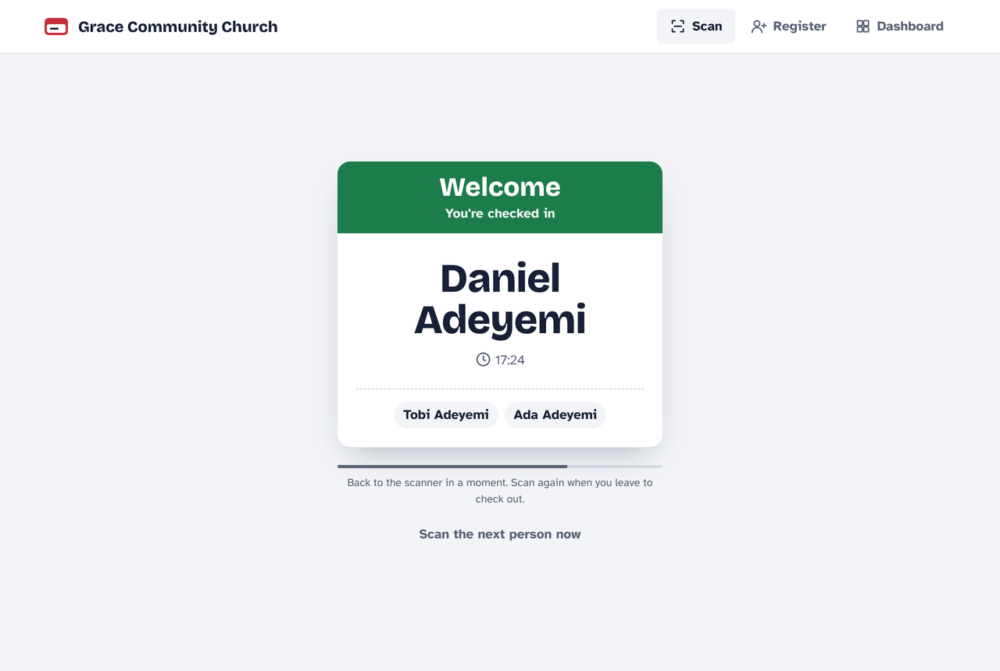
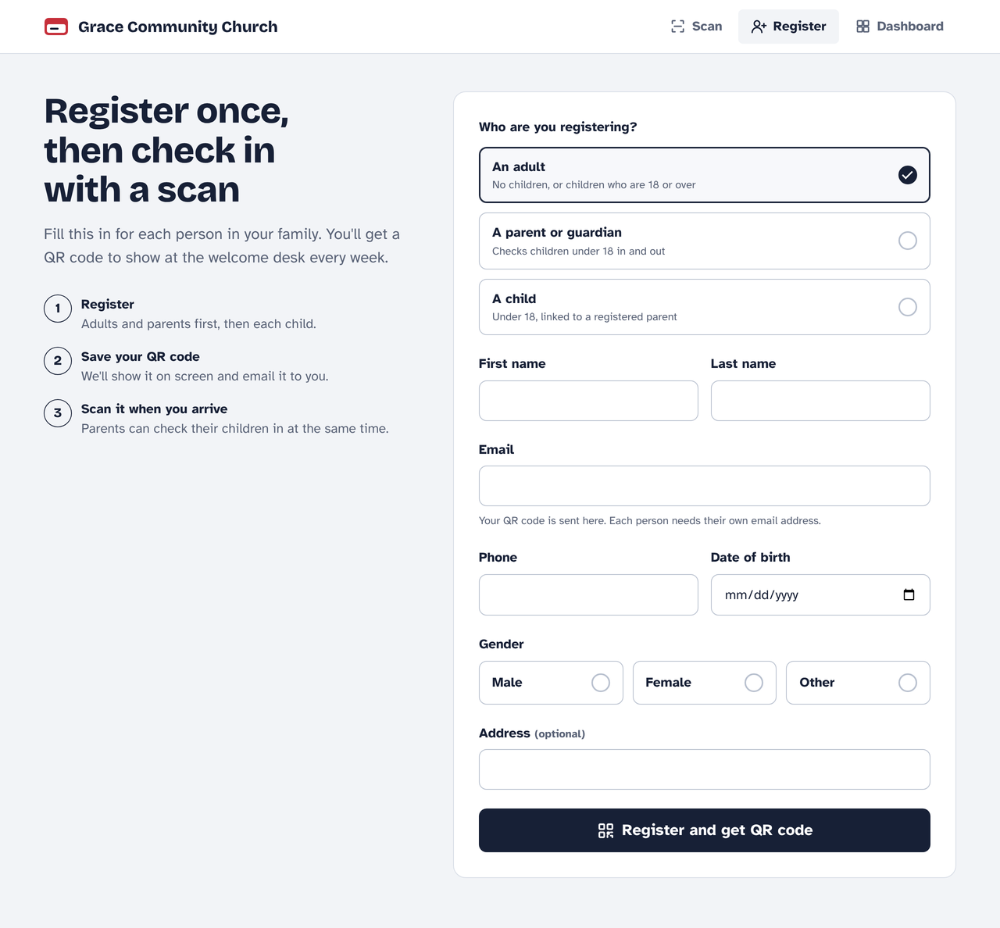
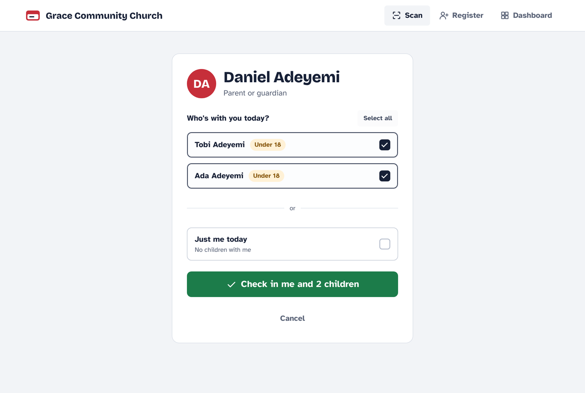
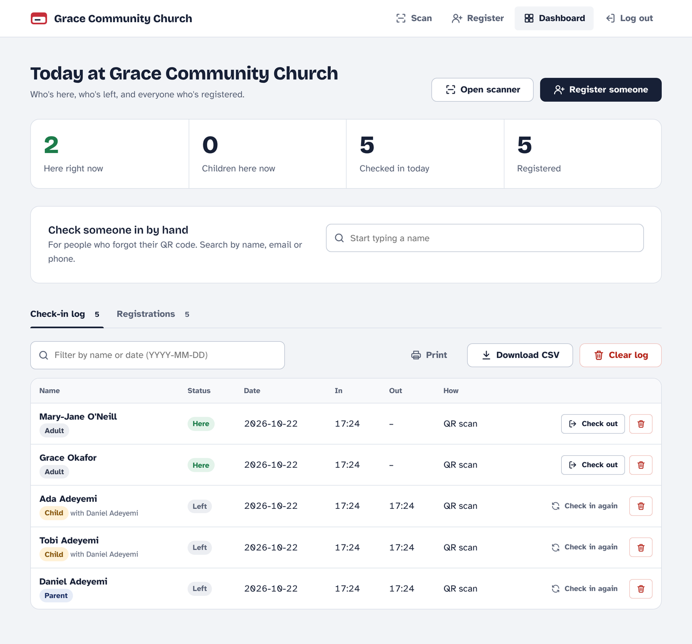
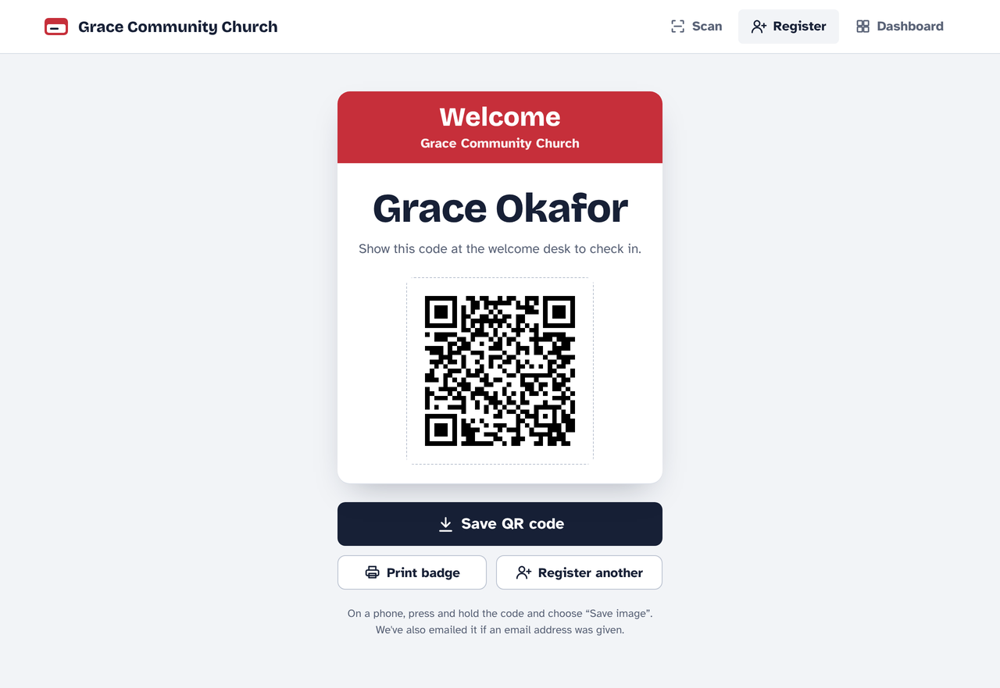
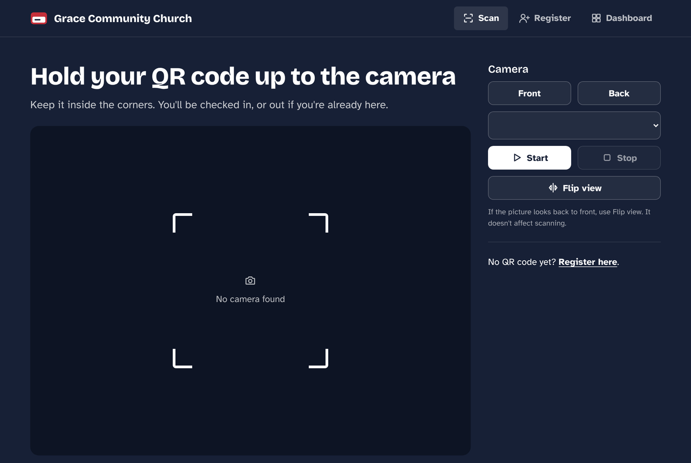
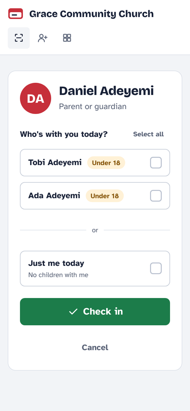

# QR Check-In

A check-in and check-out system for churches, kids' clubs and small events. People register once, get a QR code, and scan it at the door. Parents check their children in and out with the same scan, and volunteers see who's in the building from a PIN-protected dashboard.

Built with Flask and plain CSV files, so it runs on a single laptop on the church Wi-Fi with no database and no internet connection.

<p align="center">
  
</p>

## What it does

- **Register once.** Adults, parents and children each get a record and a QR code, shown on screen as a printable name-tag badge and emailed if email is configured.
- **Scan to check in or out.** The scanner runs in the browser on any tablet or laptop camera. Scanning a code checks the person in, or offers to check them out if they're already here.
- **Families together.** When a parent scans, they choose which children are with them. On the way out they choose who's going home with them.
- **Admin dashboard.** Live counts (here now, children here, checked in today), a searchable log, hand check-in for forgotten codes, and registration management.
- **Works offline.** Fonts, icons and the QR scanning library are bundled, so nothing loads from the internet.

| Register | Family check-in | Dashboard |
|---|---|---|
|  |  |  |

| QR badge | Scanner | On a phone |
|---|---|---|
|  |  |  |

## Run it

Requires Python 3.9 or newer.

```bash
cd church_attendance_clean
python -m venv .venv
source .venv/bin/activate          # Windows: .venv\Scripts\activate
pip install -r requirements.txt

ADMIN_PIN=2468 ORG_NAME="Grace Community Church" python app.py
```

The app opens in your browser and listens on your local network, so other devices on the same Wi-Fi can reach it at `http://<this-computer's-IP>:5000`. Camera access needs either `localhost` or HTTPS; on a tablet, open the scanner over HTTPS or run the app on the tablet itself.

| Page | Who uses it |
|---|---|
| `/scan` | The kiosk at the door |
| `/register` | New people, or a volunteer registering them |
| `/dashboard` | Volunteers and leaders (needs the admin PIN) |

## Settings

Set these as environment variables before starting the app.

| Variable | What it does | Default |
|---|---|---|
| `ADMIN_PIN` | PIN for the dashboard | `4321` (change it) |
| `ORG_NAME` | Name shown in the header, badges and emails | `Church Check-In` |
| `SECRET_KEY` | Keeps admins logged in across restarts | random each start |
| `EMAIL_HOST`, `EMAIL_PORT`, `EMAIL_USER`, `EMAIL_PASS` | SMTP details for emailing QR codes | email off |
| `FLASK_DEBUG` | Set to `1` for development only | off |
| `PORT` | Port to listen on | `5000` |

## How it's built

- `app.py` holds every route. Registrations and attendance live in `data/registrations.csv` and `data/logs.csv`, created on first use.
- A QR code encodes a check-in link containing `first|last|role`. Scanning it opens `/check-in`, which logs the person, or redirects to `/check-out` if they're already in today.
- Parents list their children's first names when registering; the app adds the family surname so the parent's scan and each child's own code refer to the same person.
- Templates share one layout (`templates/base.html`) and one stylesheet (`static/css/app.css`). Type is Bricolage Grotesque for headings and Atkinson Hyperlegible for text, chosen because it was designed for readability at a glance.

## Privacy

The CSV files hold names, contact details and dates of birth, including children's. They're excluded from git by `.gitignore` and should stay on the check-in machine. Dashboard pages and the data endpoints (`/api/logs`, `/search-registrations`) require the admin PIN.

## Packaging for Windows

The app supports PyInstaller, so it can be shipped as a single `.exe` for a church office PC:

```bash
pip install pyinstaller
pyinstaller --onefile --add-data "templates;templates" --add-data "static;static" app.py
```

Data files are written next to the `.exe`.

## Licence

MIT. Bundled fonts are under the SIL Open Font License and the scanning library (html5-qrcode) under Apache 2.0; their licence files are in `static/fonts` and `static/vendor`.
